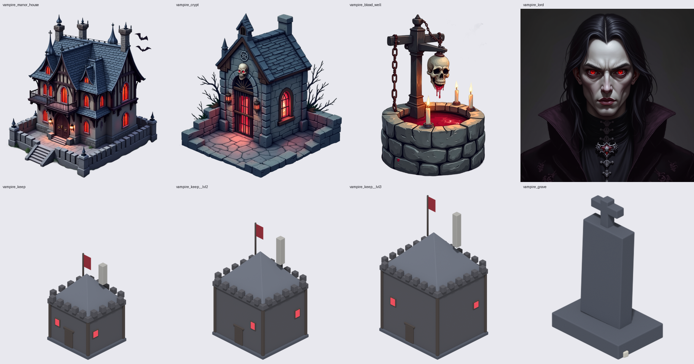
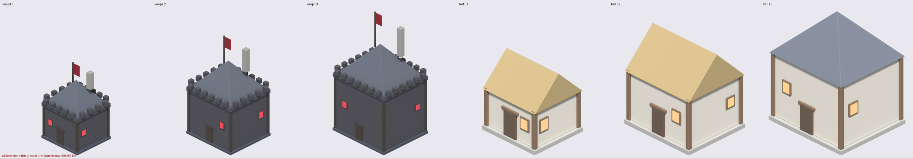

# ArtWorkflow

A manifest-driven game-art pipeline that turns a JSON spec into validated, engine-checked assets
using only local tools — built so an **agent can run it**, not just a human.

Two generation paths feed one processing, validation and export chain:

| path | produces | why |
| --- | --- | --- |
| **ComfyUI + FLUX.1-dev** | painted buildings, props, portraits, textures | the richness diffusion gives you for free |
| **Blender procedural** | exact upgrade tiers, props, animation frames | one camera per family, frames that cannot drift |

Then it cuts out backgrounds, validates every asset against configurable checks, packs
spritesheets, exports to the engine, and **verifies the result by loading it in headless Godot**.



*Top: painted through ComfyUI + FLUX, cut out with BiRefNet. Bottom: procedural through Blender —
one measured camera per upgrade-tier family. Both belong to the same art direction.*

## Why this exists

Asking a diffusion model for game art gets you a nice image and no asset. It does not guarantee
transparency, a tile-consistent ground line, matching sizes across upgrade tiers, loopable
animation, or anything an engine can load. Asking an agent to "make me some sprites" gets you a
confident summary of files that were never checked.

This pipeline is the boring part: a manifest, seven stages, checks that can actually fail, and a
status a human can trust. `review_required` means a person should look at it. It is not a pass, and
no stage is allowed to pretend otherwise.

## Quick start

```bash
git clone https://github.com/mo1998/artworkflow.git
cd artworkflow
python3 -m venv .venv                      # Python 3.9+
.venv/bin/python -m pip install pillow numpy pyyaml   # that is the whole dependency list

.venv/bin/python scripts/env_check.py     # resolve every tool, prove the toolchain works
.venv/bin/python scripts/run_pipeline.py  # generate → process → validate → export → report
```

`env_check` finds ComfyUI, its python, Blender and Godot by itself (environment variable, then
common install locations, then PATH). Machine-specific overrides go in
`config/pipeline.local.yaml`, which is untracked — that is why nothing in this repo hardcodes a
path.

**Requirements for generation:** ComfyUI with a FLUX checkpoint and the `ComfyUI_BiRefNet_ll`
custom node, and/or Blender 4.x. Godot 4.x is optional (only for the engine-side check).
**The pipeline itself needs no GPU** — processing, validation, export and the report run anywhere
with Pillow and numpy, so you can validate an asset set on a laptop.

## Use it from an agent

**MCP tools** — 13 tools over stdio, standard library only, no SDK:

```bash
claude mcp add artworkflow -- python3 /abs/path/to/artworkflow/mcp_server/server.py
export MCP_TIMEOUT=900000   # generation is slow; raise the client's tool timeout
```

`artworkflow_manifest`, `_styles`, `_asset_status`, `_inspect` and `_env_check` are instant and
read-only. `artworkflow_generate`, `_process`, `_spritesheet`, `_validate`, `_export`,
`_godot_check`, `_report` are the stages, and `artworkflow_run` does the lot. See
[`mcp_server/README.md`](mcp_server/README.md) for OpenCode, Cursor and generic client config.

**Skill** — `skills/artworkflow/` is an installable skill for Claude Code / OpenCode style agents:
a `SKILL.md` with the workflow and the non-negotiable rules, plus `references/` for the manifest
schema, authoring styles, the material palette, upgrade tiers, validation and troubleshooting.

```bash
cp -r skills/artworkflow ~/.claude/skills/           # Claude Code
cp -r skills/artworkflow ~/.config/opencode/skills/  # OpenCode
```

The skill and the MCP server are two doors into the same scripts. Without either, the CLI is the
whole interface.

## How it works

```
config/manifest.json + styles.yaml
        │
        ├─ ComfyUI + FLUX.1-dev ──┐
        └─ Blender procedural ────┤
                                  └─► process ──► spritesheet ──► validate ──► export ──► Godot check
                                      (BiRefNet    (sheets +        (statuses,   (approved/   (loads every
                                       cutout,      frame rects)     duplicates)  + mirror)    texture)
                                       trim, anchor)                    │
                                                                        └─► records ──► report.md
```

Each stage is a separate script and a separate process, so a stage can be rerun alone, a crash is
contained to one stage, and every stage keeps its own transcript. `run_pipeline.py` only sequences
them.

| stage | script | writes |
| --- | --- | --- |
| generate | `comfyui_generate.py`, `blender_generate.py` | `assets/incoming/`, `assets/animations/` |
| process | `process_images.py` | `assets/processed/` |
| spritesheet | `generate_spritesheet.py` | `assets/spritesheets/` |
| validate | `validate_assets.py` | statuses on the records |
| export | `export_assets.py` | `assets/approved/` + the Godot mirror |
| godot | `godot_check.py` | engine-side verification |
| report | `build_report.py` | `reports/<run id>.md` and `.json` |

## Contributing

```bash
.venv/bin/python scripts/check.py     # static sweep + the whole test suite
```

Tests must pass without a GPU, ComfyUI, Blender or Godot, and CI runs on Python 3.9, 3.11 and 3.12.
[`CONTRIBUTING.md`](CONTRIBUTING.md) has the invariants table — what else to update when you rename a
clip, add a stage, add a config key or add a dependency — so CI does not have to tell you.

## Learn more

The reference documentation lives with the skill, so there is exactly one copy of it:

| read | for |
| --- | --- |
| [`manifest.md`](skills/artworkflow/references/manifest.md) | every manifest field, animation clips, what the validator enforces |
| [`styles.md`](skills/artworkflow/references/styles.md) | adding an art direction, and the prompt rules learned by measurement |
| [`materials.md`](skills/artworkflow/references/materials.md) | the procedural palette contract and the emissive clipping trap |
| [`tiers.md`](skills/artworkflow/references/tiers.md) | what an upgrade tier is, and how the family camera is chosen |
| [`validation.md`](skills/artworkflow/references/validation.md) | every check, what it catches, why some are scoped |
| [`troubleshooting.md`](skills/artworkflow/references/troubleshooting.md) | symptoms seen in practice and their cause |

## Verified, on this repo's own output

```
assets: 16  exported: 16  failed: 0  review_required: 0  retried: 0
godot ok: 68 texture(s), 3 sheet(s), 52 frame rect(s)
python3 -m unittest discover -s tests   ->  42 tests, OK
```

Reproducibility, measured rather than assumed:

- **Procedural renders are pixel-identical** across a forced rerun — 0 of 65 536 pixels differ.
  Not byte-identical, because Blender stamps a `tEXt Date` chunk, so records store a
  `pixel_hash` of the RGBA bytes rather than a file hash.
- **Processed PNGs are byte-identical** across a forced rerun.
- **Painted assets are byte-identical too** on the same seed, checkpoint, workflow and ComfyUI
  version — which is why every record stores the workflow path and a SHA-256 prefix of it.



See [`reports/final.md`](reports/final.md) for the full run report, including the per-asset
provenance table and any missing licences.

## Layout

```
config/            pipeline.yaml, styles.yaml, manifest.json, JSON schema
workflows/comfyui/ API-format graphs + binding maps (flux_txt2img, birefnet_cutout)
scripts/           the seven stages, env_check, make_gallery, and lib/ (common, manifest,
                   comfy, blender, tools, imageops, stage)
blender/           generate_building.py, generate_prop.py, render_animation.py,
                   lib/ (scene with PALETTE, anim_clips, fit_framing)
mcp_server/        MCP stdio server exposing the pipeline as 13 tools
skills/artworkflow SKILL.md + references/ — the agent-facing package
godot_project/     headless import + engine-side load verification
assets/            incoming, processed, animations, spritesheets, approved  (gitignored)
metadata/          asset_records/ (committed: the provenance), manifests/
reports/           run reports (committed)
tests/             42 unit tests, no GPU needed
docs/gallery/      generated example images, via scripts/make_gallery.py
```

## Known limitations, honestly

1. **FLUX will not give you a straight-down map view.** Its prior is isometric. The style blocks
   describe what the model actually produces instead of fighting it.
2. **Negative prompts are advisory.** The vampire manor's negatives ban bats and fence lines, and
   the render has both. A first portrait grew a watermark with `watermark` in the negatives.
   Anything that must not appear needs a detector, not a prompt.
3. **Painted assets look richer than procedural ones.** Matching palette, framing and lighting make
   them sit together; hand-authored materials or textures would close the rest of the gap. The
   pipeline does not pretend the two paths have equal fidelity.
4. **A turntable always has angles where a thin feature is edge-on.** That is what rotation is for.
5. **Animation comes from clips, not prompts.** The character-rig path
   (`blender/reusable_rigs/`) is not implemented; a half-working rig generator would produce
   assets that look animated until you check the feet.
6. **Technical checks are not art direction.** The validator finds a cropped roof and a broken
   loop. It cannot tell you a face looks wrong.
7. **Licences are the user's problem.** FLUX.1-dev is non-commercial. The manifest records a
   licence per asset and the report flags any that are missing.
8. **One GPU job at a time.** ComfyUI and Blender are serialised on purpose.

## Licence

MIT for the code — see [LICENSE](LICENSE). Third-party models, checkpoints and custom nodes carry
their own licences; FLUX.1-dev is non-commercial. Verify before shipping anything this pipeline
produces.

The original brief this project grew out of is archived at
[`docs/original-brief.md`](docs/original-brief.md); the implementation diverges from it where
measurement disagreed (see the limitations above).
